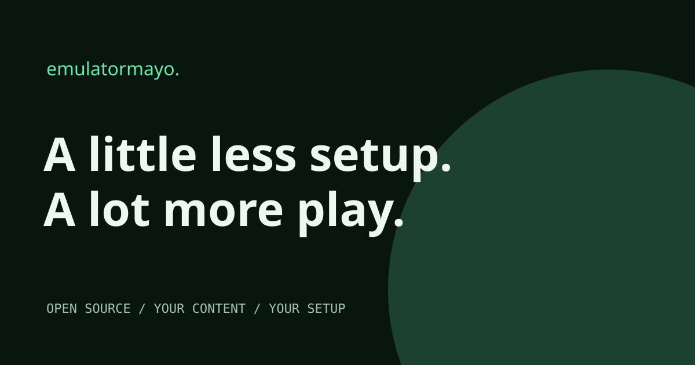
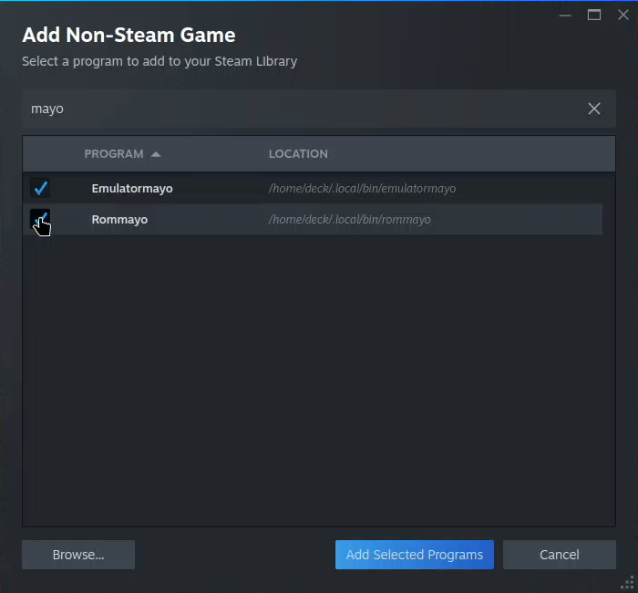
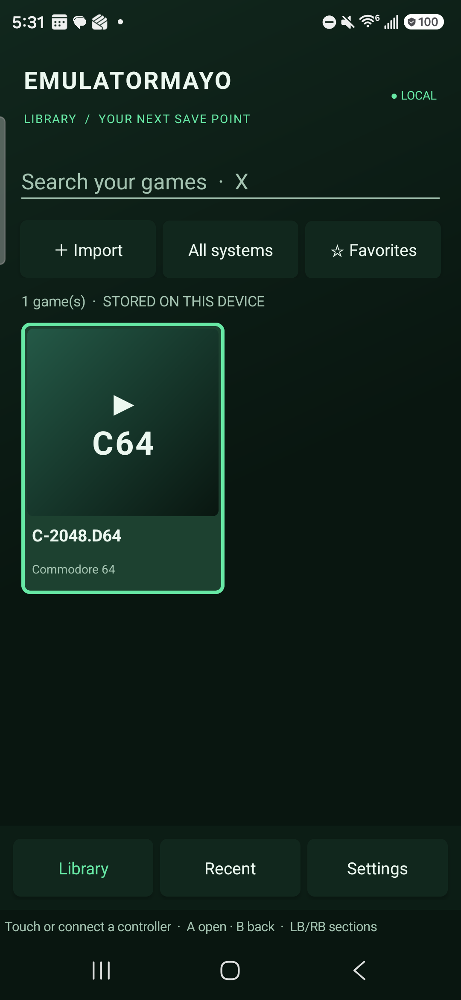

<p align="center"></p>

# Emulatormayo · Native Android, desktop player & website

**[Visit emulatormayo.quentinmayo.com](https://emulatormayo.quentinmayo.com)** for product details, setup and compatibility notes.

A public, login-free Next.js website for Emulatormayo. Dark library-inspired design, original fictional cover art, responsive layouts and an interactive preview. No games, BIOS files, server credentials, analytics or visitor accounts are included.

## Download & install

**No Node.js, npm, Docker or server required for the Android and desktop apps.** Install Emulatormayo, choose a supported system and your own local game file, then press play. The pinned EmulatorJS runtime is included.

| Platform | Download |
| --- | --- |
| Android 10+ | [Download signed APK](https://github.com/securelyprogramming/emulatormayo.quentinmayo.com/releases/download/android-v0.2.2/Emulatormayo-0.2.2-android.apk) |
| macOS Apple Silicon | [Download DMG](https://github.com/securelyprogramming/emulatormayo.quentinmayo.com/releases/download/desktop-v0.1.4/Emulatormayo-0.1.4-mac-arm64.dmg) |
| macOS Intel | [Download DMG](https://github.com/securelyprogramming/emulatormayo.quentinmayo.com/releases/download/desktop-v0.1.4/Emulatormayo-0.1.4-mac-x64.dmg) |
| Windows x64 | [Download installer](https://github.com/securelyprogramming/emulatormayo.quentinmayo.com/releases/download/desktop-v0.1.4/Emulatormayo-0.1.4-win-x64.exe) |
| Linux x64 / Steam Deck | [Download AppImage](https://github.com/securelyprogramming/emulatormayo.quentinmayo.com/releases/download/desktop-v0.1.4/Emulatormayo-0.1.4-linux-x86_64.AppImage) |

[Release notes & all assets](https://github.com/securelyprogramming/emulatormayo.quentinmayo.com/releases/tag/desktop-v0.1.4) · [SHA-256 checksums](https://github.com/securelyprogramming/emulatormayo.quentinmayo.com/releases/download/desktop-v0.1.4/SHA256SUMS.txt) · [Desktop guide](desktop/README.md)

On Android, install the APK, tap Import, choose a system and select your own games. The Steam-inspired library, search, favorites, recents, import and controller settings use native Android Views. WebView handles gameplay only. See [Android release notes & checksums](https://github.com/securelyprogramming/emulatormayo.quentinmayo.com/releases/tag/android-v0.2.2).

Open the DMG or Windows installer. On Linux, make the AppImage executable; Steam Deck users should follow the [illustrated guide](https://emulatormayo.quentinmayo.com/steam-deck) for the generated launcher or full manual launch options. Mac apps are ad-hoc signed and not notarized; Windows installers are unsigned. Saves stay in the app's local profile; export backups before deleting app data or moving devices. Installation and Desktop Mode launch have been tested on a real Steam Deck; see the illustrated Steam Deck guide for the current gameplay and controller test status.

Prefer hosting it yourself? The optional **[private self-hosted browser player](selfhost/README.md)** remains available with Docker. It is separate from this public product website. The [native Android APK](android/README.md) includes its runtime and needs no login or server.

## Tested devices

Physical hardware checks recorded October 22, 2026. These are specific smoke tests, not certification of every game, core or controller. CI builds for Windows and Intel Mac do not count as physical device tests. No device serials or private server details are published.

| Device | Environment | Verified | Still to check |
| --- | --- | --- | --- |
| Samsung Galaxy S24 Ultra | Android 17 | Signed APK; native local library; C64 homebrew boot; touch controls and player toolbar visible. | Physical external-controller gameplay not verified. |
| Retroid Pocket 5 | Android 13 | Signed APK; native landscape library; local C64 import and core boot; owner confirmed D-pad, left-stick and A/B native menu navigation. | Gameplay forwarding passes device automation; physical gameplay direction retest pending. |
| Steam Deck | SteamOS, docked 1920 × 1080 | Linux 0.1.4 candidate: Steam shortcut launch in Desktop Mode, NES test-suite boot, compact fullscreen touch toggle, Cancel/Exit returning to file selection, and remembered touch-control preference. Earlier AppImage installation, toolbar pause/resume and Quit checks also passed. | Current-update Gaming Mode and physical gameplay controls remain under test. |
| MacBook Pro (Apple M4 Pro) | macOS, Apple Silicon | C64 core boot; visible player toolbar; pause/resume; save-state export. | Other emulator cores and systems are not certified. |

[Setup and current device notes](https://emulatormayo.quentinmayo.com/getting-started#tested-devices).

## Develop this website locally

```sh
npm ci
npm run dev
```

`npm run build` creates a static export in `out/`. The Docker image builds the Next.js source and serves it with unprivileged Nginx on port **8080**. No production Node server or environment secrets are required by the public site.

## Deploy with Coolify

Use a dedicated project and a public Git application, branch `main`, Dockerfile build pack, `/Dockerfile`, exposed port `8080`, health check `/`, and the HTTPS production domain above. The app runs independently of the upstream game service.

The repository's workflow calls the organization's pinned centralized security workflow, runs the production build and dependency audit, and requests a Coolify deployment only after both pass on `main`. Configure repository variable `COOLIFY_APPLICATION_UUID` and secret `COOLIFY_API_TOKEN`; credentials never go into the source or browser bundle. Organization onboarding attaches the shared security configuration and runner access.

## Security & responsibility

Centralized scans include CodeQL plus centralized secret detection, dependency, infrastructure and workflow analysis as provided by `securelyprogramming/security-workflows`. A configured workflow is not proof that a particular scan has passed; inspect the latest Actions results and Security tab.

Use only content you are authorized to access. Downloads and use are at your own risk. This independent companion is not affiliated with upstream projects or Valve. No third-party ROM sourcing is supported. Website code is MIT licensed; upstream applications, runtimes and emulator cores retain their own licenses.

## Support the developers ☕

I need help affording my AI token usage :) If this project makes your setup a little more fun, [buy the developers a coffee](https://buymeacoffee.com/quentinmayo). Always optional. Always appreciated. The project stays free and open source.

## Search & sharing

The public site includes descriptive page titles, canonical URLs, indexable HTML, PNG social cards, WebSite/Person JSON-LD, a linked [setup guide](https://emulatormayo.quentinmayo.com/getting-started), `robots.txt` and a three-page sitemap. Each page has its own canonical URL and social metadata. Keep titles, descriptions and sitemap entries in sync when adding pages; regenerate `public/og.png` from `public/og.svg` if the social artwork changes.

For indexing diagnostics, verify the production domain in Google Search Console or Bing Webmaster Tools, submit `/sitemap.xml`, and inspect the home and guide URLs. These tools require the site owner's account; publishing metadata does not register the site or guarantee a ranking.

## One-line desktop & Steam Deck setup

In Steam Deck **Desktop Mode**, open Konsole and run:

```sh
curl -fsSL https://emulatormayo.quentinmayo.com/steam-deck.sh | bash
```

For macOS or Linux desktop, run `curl -fsSL https://emulatormayo.quentinmayo.com/install.sh | bash`. [Read the installer](scripts/install.sh) before running it. It verifies the packaged release’s SHA-256 before installing into your account, preserves existing game profiles, and needs no sudo, npm or server. Windows users can use the installer in Downloads above.

In Desktop Mode, open **Steam → Games → Add a Non-Steam Game** and select **Emulatormayo**. Return to **Gaming Mode → Library → Non-Steam**. The installed launcher includes `--deck`; leave Proton/Compatibility disabled. Choose your own local game file in the app and configure gameplay controls through EmulatorJS. Save/export progress before leaving.

Follow the [illustrated Steam Deck guide](https://emulatormayo.quentinmayo.com/steam-deck) for screenshots, controls and troubleshooting.



<p align="center"></p>

The green Android library shown on a Galaxy S24 Ultra. The tile is an app-generated system placeholder, with no game artwork.

Focused [security review and limits](docs/security-review-2026-10-22.md).

Android contributors: [controller menu validation](docs/android-controller-tests.md) covers focus movement and the physical handheld checklist.

## Boogie Woogie co-op preview

Android now includes a native **Co-op** section powered by the shared [Boogie Woogie project](https://github.com/securelyprogramming/boogie-woogie). It also runs as its own Android app, browser guest and native SDL desktop/Steam Deck guest. The current Android host supports NES games, shared Player 1, one independent Player 2 and watch-only guests; every join requires host approval. Players 3/4, Bluetooth transport and native desktop hosting remain future work.

Use [the setup guide](https://github.com/securelyprogramming/boogie-woogie/blob/main/docs/setup.md) to start a private HTTPS LAN broker and import host/guest pairing files. Co-op saves remain host-local in this preview; they are not interchangeable with the native Qt/SDL player's RomM-synchronized states. Standalone and embedded installations keep separate pairing and checkpoints.

For Android source builds, initialize the pinned shared module and prepare its verified runtime before running Gradle:

```sh
git submodule update --init --recursive
python3 -m venv .venv-boogie
.venv-boogie/bin/python -m pip install -r modules/boogie-woogie/scripts/requirements-runtime.txt
.venv-boogie/bin/python modules/boogie-woogie/scripts/prepare-runtime.py
```

Use JDK 21 and Android SDK 36. [Android module details and display/audio settings](https://github.com/securelyprogramming/boogie-woogie/blob/main/android/README.md) describe the supported options and per-game defaults. These are frontend improvements; the emulator cores remain unchanged. Source integration and automated checks do not establish a new public APK release; complete device and corresponding-source acceptance is tracked before distributing runtime-bearing builds.

In Emulatormayo, open **Co-op** to join, or select an imported NES game and choose **Play co-op** to host. Emulatormayo remains local and needs no account. The source build also needs its existing `python desktop/scripts/prepare-runtime.py` step for the ordinary local player.
